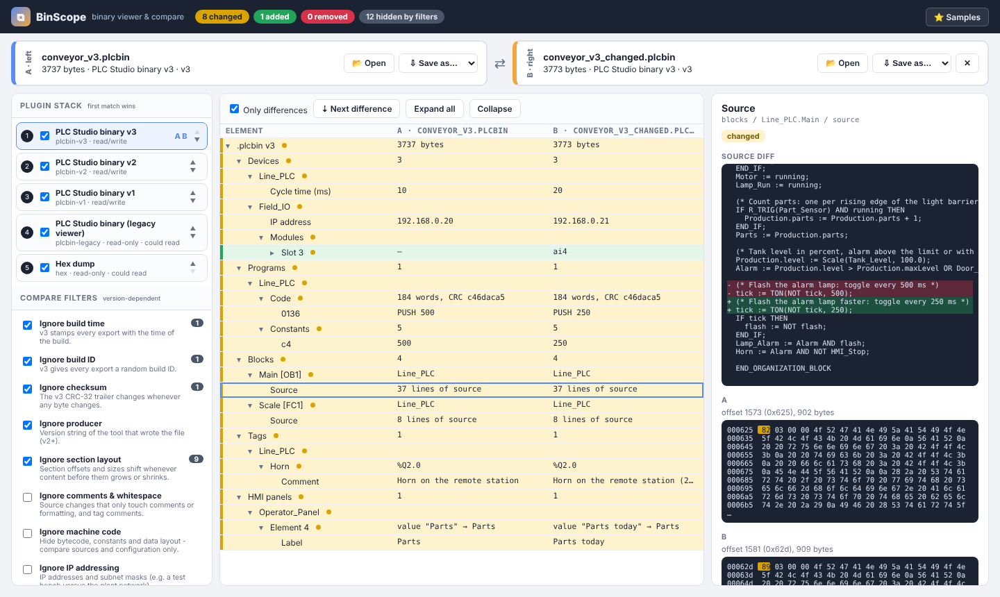
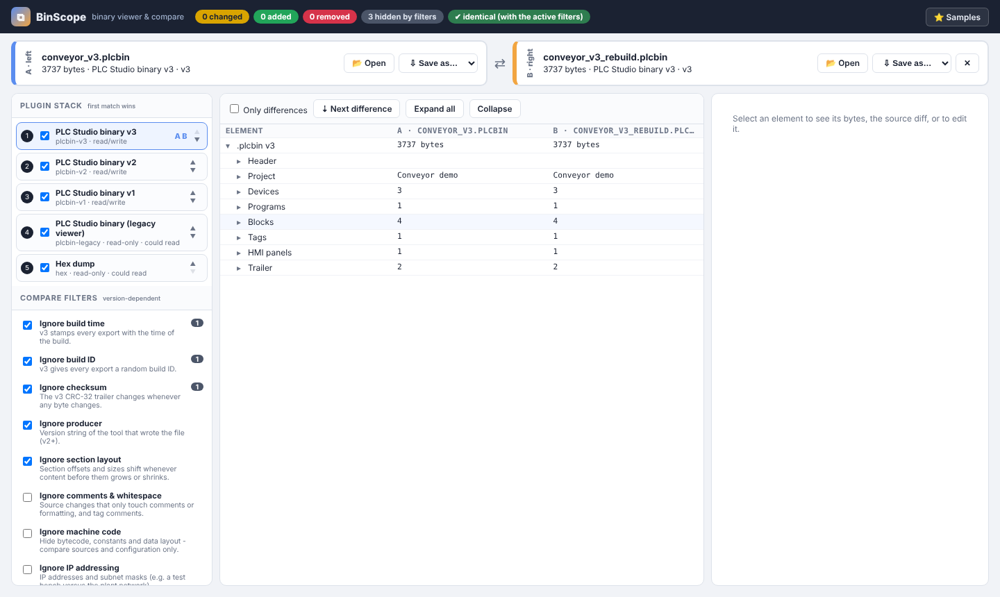
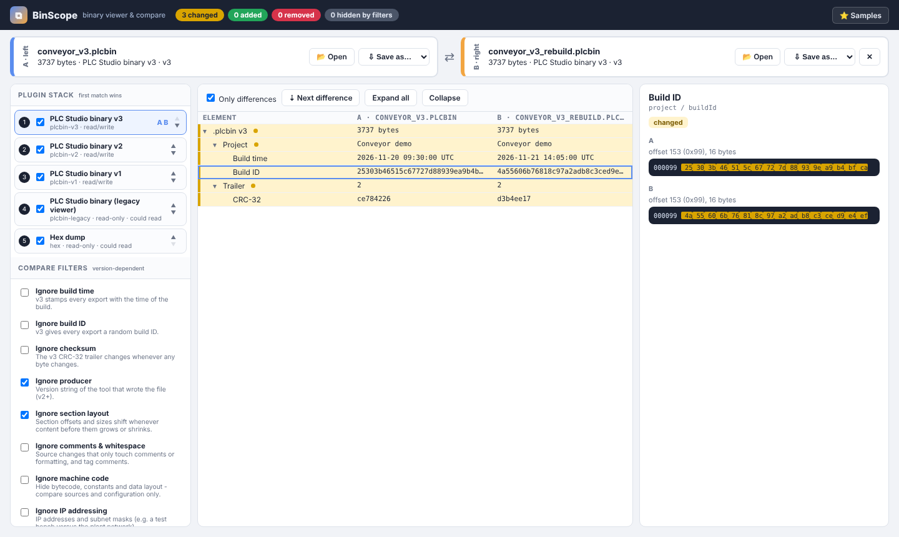
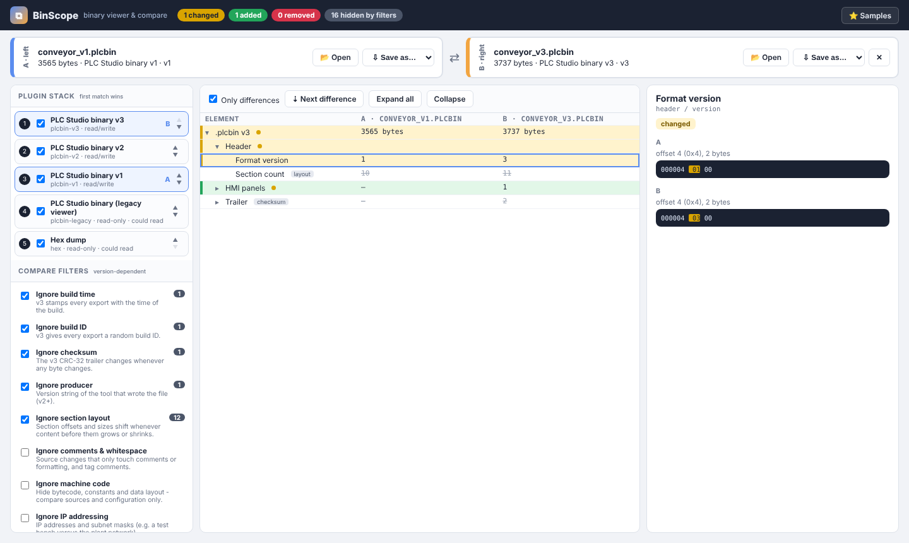
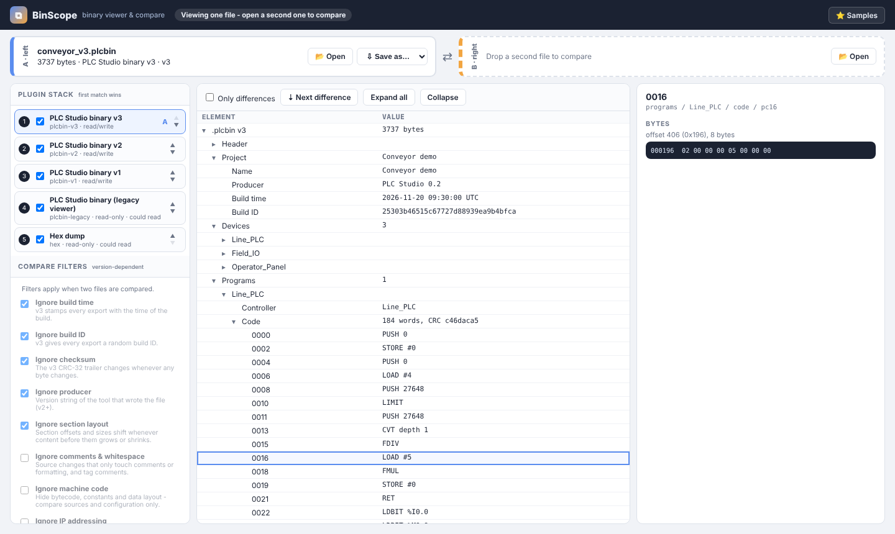
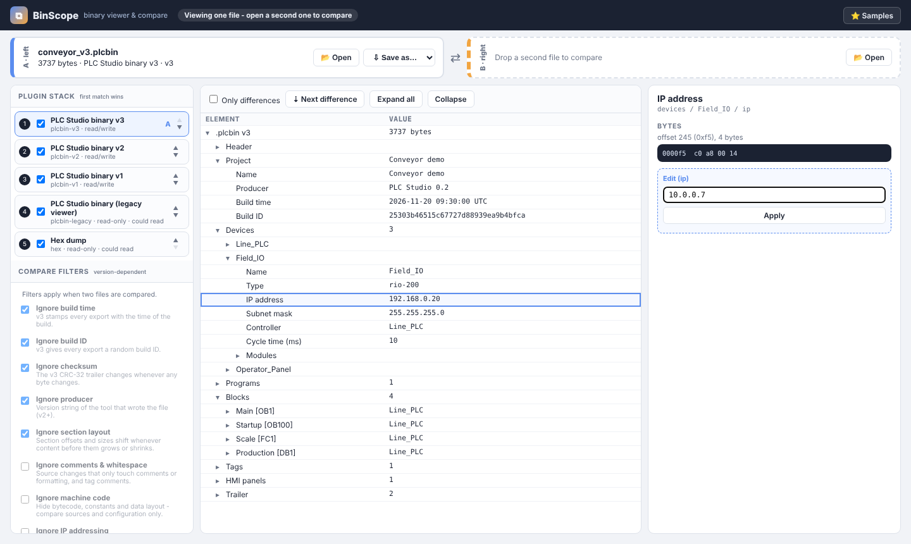
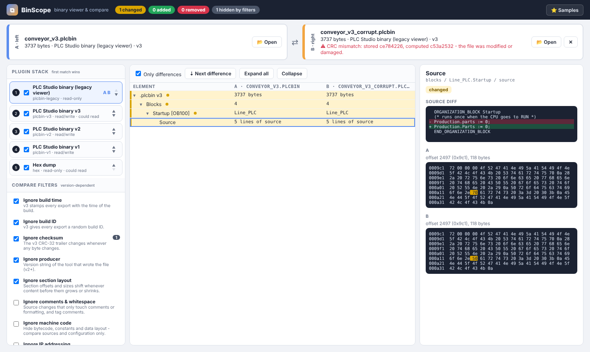
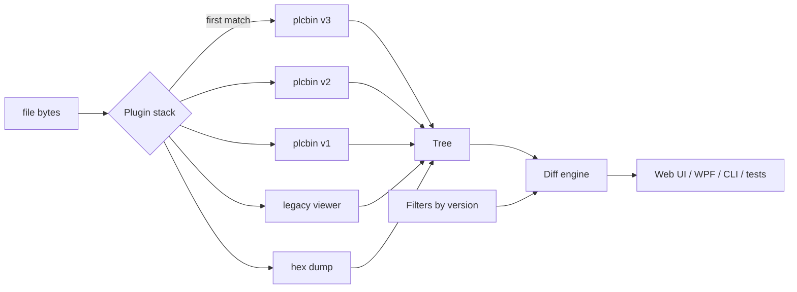

# BinScope

**A plugin-based viewer and compare tool for binary files – in the browser and as a .NET library, CLI and desktop app.**

### ▶️ [Try it in the browser](https://tibortoth8807.github.io/BinScope/) – no install, sample files built in

[](https://github.com/tibortoth8807/BinScope/actions/workflows/web.yml)
[](https://github.com/tibortoth8807/BinScope/actions/workflows/dotnet.yml)

BinScope opens compiled project files of [PLC Studio](https://github.com/tibortoth8807/PlcStudio) (`.plcbin`), shows them as a tree – hardware, compiled code with disassembly, block sources, tags, HMI screens – and compares two of them. The question it answers is the one every build engineer asks: **what really changed between these two binaries?** A rebuild without changes is not byte-identical (timestamps, build IDs, checksums), so a plain byte compare is useless. BinScope filters that noise out, and the filters know which format version they apply to.



## Why a web version *and* a .NET version

Desktop-only compare tools tend to end up in many different versions on many machines, and nobody is sure which one is current. BinScope has the same core in two implementations:

| | Where it runs | Used for |
|---|---|---|
| **Web** (`web/`, TypeScript) | Any browser, deployed to GitHub Pages | Open a link, drop two files, done. Always the latest version. |
| **BinScope.Core** (`dotnet/`, C# / .NET 10) | Library (API dll) | Integration tests, build pipelines, other tools |
| **binscope CLI** (.NET and Node) | Command line, CI | `binscope compare a.plcbin b.plcbin` – exit code 0/1/2 like `diff` |
| **BinScope desktop** (WPF) | Windows | Local work with drag & drop |

The two implementations are kept in step by **parity tests**: the TypeScript reference writes its results for every sample file and every comparison to [`samples/expected.json`](samples/expected.json), and the .NET test suite must produce exactly the same trees, statistics and difference lists.

## Features

- **Plugin stack.** Every format is read by a plugin. Plugins are ordered by priority; the first enabled plugin that accepts a file reads it. Several plugins can understand the same file – the order decides how it is shown. Reorder or disable them in the UI and both files are read again. If a plugin fails, the next one takes over; the hex-dump plugin at the bottom accepts anything.
- **Version-dependent readers.** One full reader/writer per format version (v1, v2, v3), plus a read-only "legacy viewer" that understands all versions but shows less – like an older tool that is still around.
- **Tree view** with byte offsets and a hex preview for every element; **disassembly** of the compiled code with symbol names and I/O addresses; block sources as text.
- **Compare** by key path, not by byte position: inserting a module does not make everything after it "different". Changed / added / removed, with "only differences" and "next difference".
- **Filters** for differences you do not care about, each tied to the format versions where it makes sense (see below). Filters that do not apply to the open files are greyed out. The counter shows how much each filter hid.
- **Line diff** of block sources and byte-level highlighting of what differs.
- **Editing.** Change an IP address, a cycle time, a tag comment, an HMI label or a block source; the plugin writes the file again (the v3 checksum is recalculated). Compare the edited file with the original, save it, or **save it in another format version**.
- **Damaged files** are still read: a checksum mismatch becomes a warning, not an error.

### Filters

| Filter | Versions | Default | Hides |
|---|---|---|---|
| Ignore build time | v3 | on | the build timestamp |
| Ignore build ID | v3 | on | the random build ID |
| Ignore checksum | v3 | on | the CRC-32 trailer |
| Ignore producer | v2, v3 | on | the version string of the exporting tool |
| Ignore section layout | v1–v3 | on | section offsets and sizes, which shift when content grows |
| Ignore comments & whitespace | v1–v3 | off | source changes that only touch comments or formatting, tag comments |
| Ignore machine code | v1–v3 | off | bytecode, constants, data layout – compare sources and configuration only |
| Ignore IP addressing | v1–v3 | off | IP addresses and masks (test bench vs. plant network) |

## Screenshots

| | |
|---|---|
|  A rebuild without changes: **identical** with the default filters… |  …and the noise the filters hide: build time, build ID, checksum |
|  The same project exported as format v1 and v3 |  Viewing one file: disassembly with byte offsets |
|  Editing a value through the plugin |  Legacy viewer moved to the top; a damaged file – one flipped bit, highlighted |

## Command line

The same commands exist in both implementations.

```text
binscope plugins
binscope info <file> [--plugin <id>]
binscope compare <left> <right> [--filters a,b | --no-filters | --all-filters] [--json]
binscope set <file> <path> <value> --out <file>
```

```text
$ binscope compare conveyor_v3.plcbin conveyor_v3_changed.plcbin
conveyor_v3.plcbin (plcbin-v3) ↔ conveyor_v3_changed.plcbin (plcbin-v3)
Filters: build-time, build-id, checksum, producer, layout
  ~ devices / Line_PLC / cycle: 10 → 20
  ~ devices / Field_IO / ip: 192.168.0.20 → 192.168.0.21
  + devices / Field_IO / modules / slot3
  ~ programs / Line_PLC / code / pc136: PUSH 500 → PUSH 250
  ~ programs / Line_PLC / consts / c4: 500 → 250
  ~ blocks / Line_PLC.Main / source (source changed)
  ~ blocks / Line_PLC.Scale / source (source changed)
  ~ tags / Line_PLC / Horn / comment: Horn on the remote station → Horn on the remote station (24 V)
  ~ hmi / Operator_Panel / #3 / label: Parts → Parts today
8 changed, 1 added, 0 removed, 12 hidden by filters
```

Exit code: `0` no visible differences, `1` differences, `2` error – so it can gate a pipeline step. `--json` gives a machine-readable result.

## Using the .NET API

```csharp
using BinScope.Core.Diff;
using BinScope.Core.Plugins;

var registry = new PluginRegistry();                 // built-in plugin stack
var a = registry.Load("build_1.plcbin");
var b = registry.Load("build_2.plcbin");

var filters = DiffEngine.DefaultFilters(a.Result.Version, b.Result.Version);
var result = DiffEngine.Compare(a.Result.Tree, b.Result.Tree, filters);

foreach (var d in DiffEngine.Differences(result.Root))
    Console.WriteLine($"{d.Status} {d.PathText}: {d.Left?.Value} -> {d.Right?.Value}");
```

### Writing a plugin

```csharp
public sealed class MyFormatPlugin : IBinaryPlugin
{
    public string Id => "my-format";
    public string Name => "My format";
    public string Description => "Reads *.myf files";
    public int Priority => 250;                       // asked before plcbin-v2, after plcbin-v3

    public bool CanRead(byte[] bytes, string fileName) => bytes.AsSpan().StartsWith("MYF1"u8);

    public ReadResult Read(byte[] bytes, string fileName)
    {
        var root = TreeNode.Group("root", fileName, offset: 0);
        root.Add(TreeNode.Leaf("size", "Size", $"{bytes.Length} bytes"));
        return new ReadResult(root, Warnings: [], Version: 1);
    }
}

registry.Register(new MyFormatPlugin());              // sorted in by priority
```

Implement `IWritablePlugin` as well to support editing. Filters are `IDiffFilter` implementations and can be added the same way.

## Repository layout

```text
FORMAT.md                 the .plcbin format specification (v1-v3)
samples/                  sample files + expected.json (shared by both test suites)
web/                      TypeScript: core, CLI, web UI (Vite), node:test tests
  src/core/               bytes, model, plcbin reader/writer, disassembler, plugins, diff
  src/cli.ts              Node CLI
  src/main.ts             web UI
dotnet/
  src/BinScope.Core/      the API dll (same architecture as web/src/core)
  src/BinScope.Cli/       binscope CLI (also packable as a dotnet tool)
  src/BinScope.Desktop/   WPF desktop app
  tests/BinScope.Tests/   xUnit: parity with expected.json, core, CLI
```



## Getting started

**Web** (Node 22+):

```bash
cd web
npm install
npm run dev        # http://localhost:5173
npm test           # unit tests (core, filters, CLI)
npm run cli -- compare ../samples/conveyor_v3.plcbin ../samples/conveyor_v3_changed.plcbin
```

**.NET** (.NET 10 SDK):

```bash
cd dotnet
dotnet test                                  # parity + core + CLI tests
dotnet run --project src/BinScope.Cli -- compare ../samples/conveyor_v3.plcbin ../samples/conveyor_v3_rebuild.plcbin
dotnet run --project src/BinScope.Desktop    # Windows
```

The CI builds the desktop app and the CLI on Windows and publishes them as a workflow artifact (`BinScope-windows`).

**Your own files:** in [PLC Studio](https://tibortoth8807.github.io/PlcStudio/), click **📦 Export .plcbin** (choose v1/v2/v3), change something, export again, and open both files in BinScope.

**Samples:** `samples/` is generated from the PLC Studio demo project (`npx tsx scripts/samples.ts` in the PlcStudio repository). After a change to the TypeScript core, run `npm run samples:expected` and `npm run samples:embed` in `web/`.

## Tech

TypeScript (strict, no framework), Vite, node:test · C# 12+/.NET 10, xUnit, WPF (MVVM without libraries) · GitHub Actions: Pages deploy, Linux test job, Windows build job.

## License

[MIT](LICENSE)
